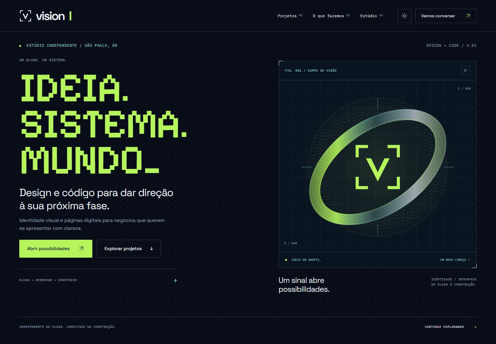

# Vision Studio

Projeto autoral de **Luiz Albuquerque**: identidade visual, landing page e documentação da construção de um estúdio independente de **design + código**.

[Ver o site](https://vision-ckp.pages.dev/)



## Sobre o projeto

A Vision nasce da intenção de aproximar negócios do meu bairro do digital. Este repositório registra a implementação do site e as decisões que conectam marca, interface e movimento. Não apresenta resultados comerciais não medidos.

O código foi desenvolvido com apoio de IA. Direção, escolha de referências, seleção de materiais e revisão foram conduzidas por Luiz. A documentação distingue entregas verificadas de intenções futuras.

## Tecnologias

- HTML: conteúdo, estrutura semântica e formulários.
- CSS: tokens visuais, grids, responsividade e movimento.
- JavaScript nativo: tema, menu, filtros, galeria e briefing.
- SVG e canvas: símbolo e campo óptico.

Sem framework, instalação de dependências ou etapa de compilação para o site.

## Rodar localmente

Abra a pasta no VS Code e use a extensão Live Server no `index.html`. Também é possível abrir o arquivo diretamente no navegador; algumas funções do navegador, como copiar para a área de transferência, podem depender de um contexto seguro.

Se você já tem Python instalado:

```sh
python -m http.server 8080
```

Depois abra `http://localhost:8080`. As fontes são carregadas pelo Google Fonts e possuem alternativas locais de sistema quando a conexão não está disponível.

## Estrutura

```text
index.html                 Conteúdo e seções do site
styles.css                 Identidade, layout e responsividade
project-covers.css         Composição editorial das capas
script.js                  Interações do site
trailer.css / trailer.js   Player do filme, carregado somente após clicar
assets/                    Imagens e símbolo utilizados na página
docs/                      Decisões, processo e roteiro de estudo
scripts/check.mjs          Verificação estrutural do site
```

## Recursos implementados

Tema claro/escuro, menu móvel, filtros, galeria com teclado, FAQ e briefing que prepara uma mensagem para WhatsApp. O visitante confirma o envio; não há backend nem armazenamento de leads nesta implementação.

A seção “A Vision em movimento” apresenta o V2 de 30 segundos antes do contato. O vídeo leve (~1,68 MB) só recebe sua fonte no clique; não toca sozinho. Inclui controles, reprodução inline no celular, legendas opcionais em português e transcrição. As legendas requerem servir a pasta por HTTP, não abrir o HTML por `file://`.

O movimento decorativo pode ser pausado e considera `prefers-reduced-motion`. Isso não equivale a uma certificação completa de acessibilidade.

## Verificar o código

Com Node.js disponível:

```sh
node --check script.js
node --check trailer.js
node scripts/check.mjs .
```

O segundo comando confere arquivos locais referenciados, âncoras, IDs duplicados e a presença de um único H1. Não substitui teste visual ou funcional no navegador.

## Processo e estudo

- [Decisões de design e implementação](docs/PROCESSO.md)
- [Roteiro para estudar o código](docs/ESTUDAR-O-CODIGO.md)
- [Motion, voz e som](docs/VIDEO-E-SOM.md)
- [Registro de evolução](CHANGELOG.md)
- [Autoria e materiais](docs/AUTORIA-E-MATERIAIS.md)

Os registros anteriores à criação deste repositório são documentação retrospectiva. Não foram fabricados commits para simular esse histórico.

## Publicação

O site é estático. Para publicar, o `index.html` deve ficar na raiz do conteúdo servido junto dos CSS, JavaScript e da pasta `assets/`. A criação deste repositório não altera o site já hospedado no Cloudflare Pages nem ativa integração automática de deploy.

## Escopo e direitos

Primeira versão privada para revisão. Não foi selecionada uma licença de código aberto. Logos, fotografias, imagens de projetos e materiais de terceiros não recebem licença aberta por estarem neste repositório. Consulte [autoria e materiais](docs/AUTORIA-E-MATERIAIS.md) antes de abrir o projeto ao público ou reutilizar os assets.

Última organização deste registro: 13/10/2026.
