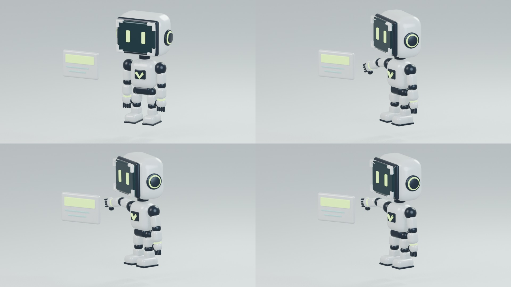

# Design, movimento e mascote da Vision

Registro de evolução com direção de Luiz Albuquerque e assistência de IA na criação dos conceitos, código, composição e documentação.

| Etapa | Entrega | Estado |
| --- | --- | --- |
| V4 clara | [Comercial, apresentação do mascote e créditos](motion/v4/README.md) | Vídeos exportados; personagem animado por camadas 2.5D. |
| Referência do personagem | [Conceito visual](mascot/references/vision-mascot-concept.png) e [atlas de partes](mascot/references/vision-mascot-parts-2d.png) | Imagens geradas por IA; não são modelos 3D. |
| Protótipo 3D | [Modelo, teste e instruções de reprodução](mascot/3d/README.md) | Geometria tridimensional e controles mecânicos funcionando; acabamento a refinar. |
| Comercial V5 | [Vídeo, composição visual e créditos](motion/v5/README.md) | Comercial de 24 segundos com os três projetos recentes. |
| Mascote oficial | [Fantasminha 3D, modelo e quatro animações](mascot/official/README.md) | Personagem aprovado por Luiz Albuquerque em 10/11/2026. |

## Por que evoluir para 3D

As primeiras versões movimentam imagens separadas de cabeça, braço e corpo. Elas serviram para explorar personalidade, flutuação e participação nas cenas, mas não fornecem novos ângulos reais do personagem.

O protótipo seguinte usa peças tridimensionais, permitindo girar corpo e câmera, revelar a lateral, articular braços e renderizar o personagem com fundo transparente. Sua aparência ainda difere do render conceitual; o teste valida a técnica antes do refinamento visual.

## Visão futura

Luiz pretende desenvolver a Vision como uma startup de IA que ajuda empresas a criar design. Nesta etapa isso é uma **visão de futuro em construção**. Os arquivos documentam experimentos de identidade e animação, não um produto de IA lançado ou resultados comerciais validados.

## Arquivos e direitos

Incluímos fontes editáveis do mascote, código do Blender e prévias pequenas. Executáveis, dependências, masters de vídeo, vozes isoladas, caches e backups não integram este registro. A publicação dos arquivos não concede licença aberta aos materiais; seguem os limites de [autoria e materiais](../docs/AUTORIA-E-MATERIAIS.md).
