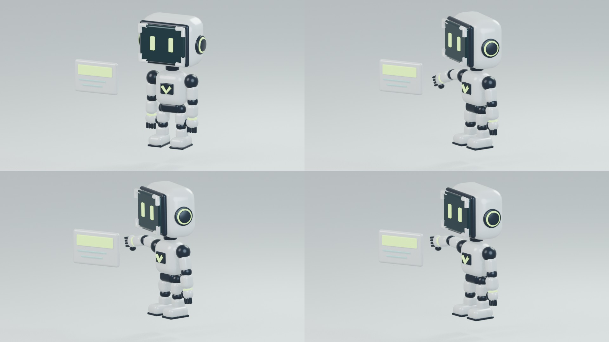

# Mascote Vision — primeiro protótipo 3D articulado

**Teste técnico, ainda em refinamento visual.** O modelo foi reconstruído com geometria tridimensional a partir da direção do personagem. Cabeça, corpo e mãos ainda precisam se aproximar do [conceito aprovado](../references/vision-mascot-concept.png).



## Arquivos

- [Prévia de cinco segundos — 960×540, 30fps, sem áudio](previews/Vision-3D-teste-5s.mp4)
- [Blender editável: modelo, materiais, controles e animação](models/Vision-Mascote-articulado-teste.blend)
- [GLB animado: apenas o personagem](models/Vision-Mascote-animado.glb)
- [Exemplo de render com fundo transparente](previews/Vision-3D-transparente.png)

O `.blend` contém cenário, card demonstrativo, câmera, luzes e animação. Está configurado para renderização em 1920×1080, 30fps. A prévia foi renderizada em resolução menor para testar movimento e enquadramento.

O `.glb` contém 58 malhas e uma animação combinada. Foi reimportado no Blender e teve as transformações de corpo e braço conferidas nos frames 1, 75 e 150. Sua aparência em outros visualizadores depende de iluminação e suporte a materiais; não foi testado em todos os motores.

## Controles e movimento

| Controle | Função |
| --- | --- |
| `CTRL_flight` | Flutuação, posição e giro de todo o personagem |
| `CTRL_head` | Direção da cabeça |
| `CTRL_shoulder_L` / `R` | Ombros e braços |
| `CTRL_elbow_L` / `R` | Cotovelos e mãos |
| `CTRL_hip_L` / `R` | Pernas |
| `CTRL_card` | Resposta do card, somente na cena demonstrativa |

O rig usa hierarquia de peças rígidas e controles de objeto, adequado a este protótipo mecânico. Não é um esqueleto humano com pele deformável. O teste inclui flutuação, giro para três quartos, gesto em direção ao card, piscada e sustentação da pose final. Não é um loop contínuo.

## Reproduzir no Blender

Testado com **Blender 4.5.15 LTS**. Os scripts usam o Python interno do Blender e não precisam de Pillow, NumPy externo, API ou credenciais. Execute os comandos a partir da raiz do repositório, em um novo processo do Blender; `blender` deve estar disponível no terminal ou ser substituído pelo caminho do executável.

```sh
blender --background --factory-startup --python design/mascot/3d/blender/build.py
blender --background --factory-startup --python design/mascot/3d/blender/animate_test.py
blender --background --factory-startup --python design/mascot/3d/blender/export_portable.py
blender --background --factory-startup --python design/mascot/3d/blender/check_glb.py
```

Os resultados novos ficam em `design/mascot/3d/build/`, ignorado pelo Git. Os snapshots revisados deste registro ficam em `models/` e `previews/`.

Para renderizar a prévia completa e gerar o exemplo transparente:

```sh
blender --background --factory-startup --python design/mascot/3d/blender/render_export.py
```

Esse comando renderiza 150 frames. O tempo depende da máquina. Os comandos anteriores já geram as poses de revisão sem exigir a renderização inteira.

## Verificações e pendências

As poses inicial, giro, gesto e final foram inspecionadas visualmente. O MP4 foi decodificado e conferido em cinco segundos / 150 frames. Os registros estruturais e da reimportação do GLB estão em [checks/](checks/).

Pendentes: acabamento mais fiel ao conceito, mãos expressivas, detalhes traseiros, revisão de colisões em movimentos novos e biblioteca de ações para produção. O teste não foi inserido no site ou no comercial.

Modelagem procedural, materiais e animação com assistência de Codex, sob direção de Luiz. Não houve geração paga de IA nesta etapa. Blender é obtido separadamente; o executável não está incluído. Consulte também [autoria e materiais](../../../docs/AUTORIA-E-MATERIAIS.md).
