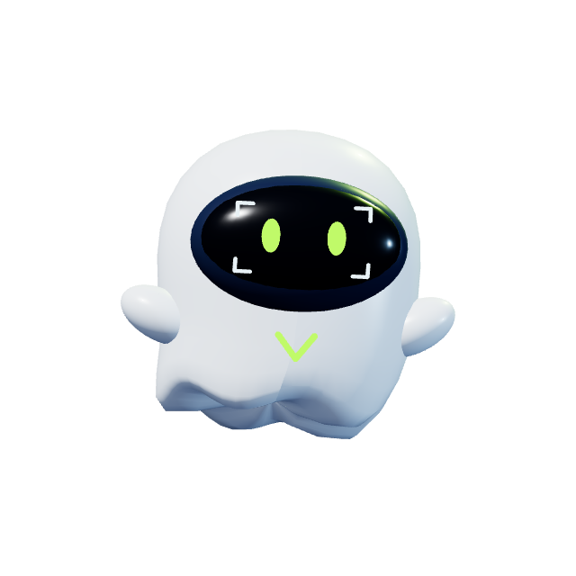

# Fantasminha da Vision

Luiz Albuquerque aprovou o personagem do comercial V5 como mascote oficial da Vision em 10/11/2026. A forma é arredondada, com acabamento perolado e barra ondulada. O visor escuro reúne os quatro cantos do enquadramento da marca e os olhos verdes. O mesmo verde marca o V no corpo.

[Modelo 3D animado em GLB](vision-fantasminha.glb) · [Demonstração dos movimentos](vision-fantasminha-demonstracao.mp4) · [Comercial V5](../../motion/v5/README.md)



## Movimentos para edição

Cada clipe tem três segundos, 640 × 640 pixels, 30 fps e canal alfa. Os movimentos retornam à pose inicial para poder repetir o clipe ou cortar para outro gesto. Use um editor com suporte a WebM VP9 com alfa para manter a transparência.

| Movimento | Ação | Arquivo |
| --- | --- | --- |
| Flutuar | Respira, sobe e desce suavemente e pisca. | [WebM transparente](animations/flutuar.webm) |
| Acenar | Levanta o braço em saudação e pisca um olho. | [WebM transparente](animations/acenar.webm) |
| Apontar | Estende o braço à direita e sustenta o gesto. | [WebM transparente](animations/apontar.webm) |
| Girar | Faz uma volta completa e retorna à frente. | [WebM transparente](animations/girar.webm) |

## Editar o modelo e os movimentos

O GLB contém as quatro animações. A malha do corpo tem 16 formas de deformação para animar a barra, e os gestos usam transformações do corpo, dos braços e dos olhos. A iluminação dos clipes vem da cena de renderização.

- [ghost.mjs](ghost.mjs) define a geometria, os materiais e os controles de pose.
- [animations.mjs](animations.mjs) define a curva de cada movimento e gera as animações do GLB.
- [renderer.mjs](renderer.mjs) fornece a câmera e a iluminação usadas na composição.

Para exportar novamente o GLB, rode na raiz do repositório com Node.js:

```sh
npm ci --prefix design/mascot/official
node design/mascot/official/export-glb.mjs
```
