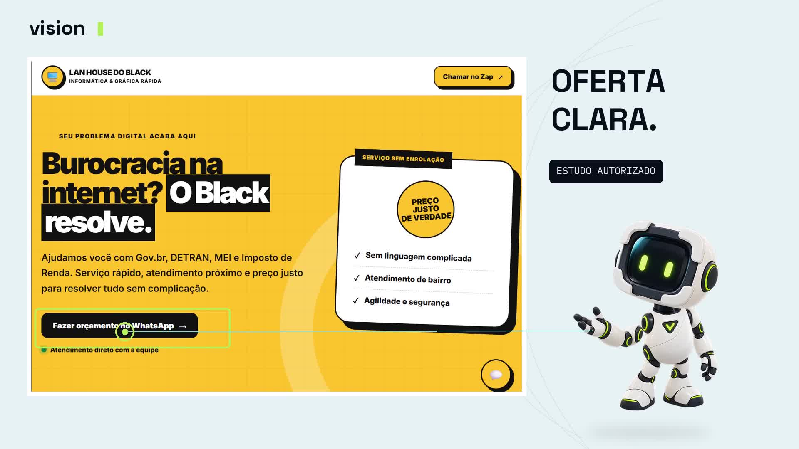

# Vision V4 — direção clara e presença do mascote

Fundo Névoa `#E8F1F5`, texto Núcleo `#080D18`, Pulso `#B5F45B` e ciano `#8EDDD8`. Tipografia Space Grotesk + IBM Plex Mono.

- [Comercial — prévia 720p60, 30 segundos](vision-v4-commercial-preview-720p60.mp4)
- [Apresentação visual do mascote — prévia 720p60, 12 segundos](vision-mascot-2d-preview-720p60.mp4)
- [Legendas em português](vision-v4-pt.srt)
- [Créditos e descrição da revisão](CREDITOS-E-REVISAO.txt)

## O que mudou

Texto mais curto, telas com proporções preservadas e participação do personagem nos destaques de contato, formulário, estrutura, design e publicação. A apresentação própria usa planos abertos e de detalhe, órbitas e um traço que forma o V.

Nesta versão, o personagem tem aparência 3D, mas seu movimento é feito por camadas de imagem com deslocamento, flutuação, sombra e rotações. Isso é diferente do [protótipo com geometria 3D](../../mascot/3d/README.md), desenvolvido na etapa seguinte.

## Voz, projetos e limites

Locução feminina Ana Alice, ElevenLabs v4. A geração original dos dois takes da V4 usou 304 créditos; a revisão de movimento reaproveitou o áudio. Música Glass and Shadow e efeitos provenientes dos arquivos fornecidos por Luiz. Não estão incluídos arquivos isolados de voz ou música.

Black é identificado como estudo autorizado. Ateliê 27 é conceitual, com pedido de horário demonstrativo. Sára Zara aparece como identidade visual com orçamento personalizado, sem sugerir que esteja incluída na landing page de R$ 500. As indicações gráficas são recursos da edição, sem representar funcionalidades novas dos sites.

Masters exportados em 1080p60; este diretório contém apenas as prévias leves. A revisão foi conferida em 30 s / 1.800 frames para o comercial e 12 s / 720 frames para o mascote. Não equivale a validação de vendas, teste com público ou revisão independente de licenças dos materiais de origem.
