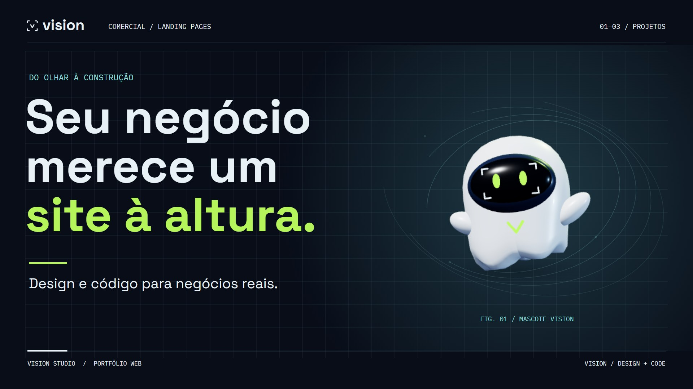

# Comercial V5

O filme apresenta Allyah Braids, Solução Protect e Ateliê 27 em 24 segundos. O mascote acompanha as mudanças de cena, indica os botões nas telas e destaca o convite para falar com a Vision.

[Assistir ao comercial em 720p60](vision-v5-720p60.mp4) · [Créditos](CREDITOS.txt) · [Mascote oficial](../../mascot/official/README.md)



## Composição visual

O enquadramento é 16:9. A versão no GitHub tem 1280 × 720 pixels a 60 fps. A composição tem resolução de 1920 × 1080 e usa imagens do portfólio, Canvas 2D e o modelo do fantasminha em Three.js. A faixa publicada inclui trilha e efeitos. A edição usa texto em tela.

Com Node.js instalado, rode na raiz do repositório:

```sh
npm ci --prefix design/mascot/official
python -m http.server 8080
```

Abra [a composição no navegador](http://localhost:8080/design/motion/v5/film.html?play) para reproduzir a imagem em loop. Para inspecionar um instante, abra `film.html` sem o parâmetro `play` e execute `window.film.frame(12.5)` no console. O áudio da versão editada está no MP4.
